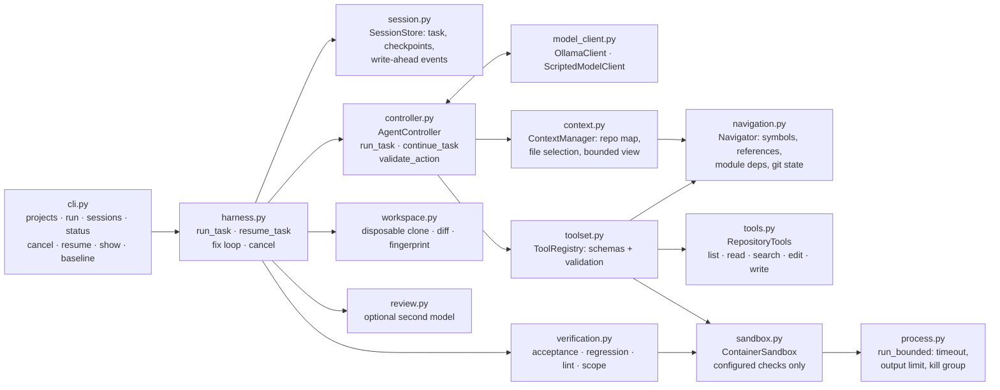
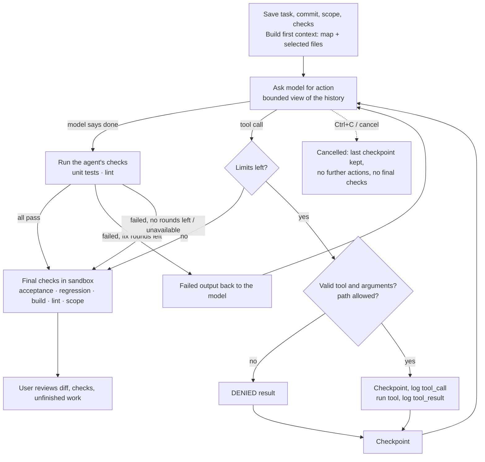

# coding-harness

| | |
|---|---|
| Lecture | Advanced AI-Assisted Software Development (AAIA) |
| Semester | Wintersemester 2026, MSE3 |
| Deliverable | Stage 2: Capable coding harness |
| Author | Michael Auß, se25m055@technikum-wien.at |

A coding harness in Python. A user picks an allowed project and a task. A local model works on a
disposable copy of the repository through validated tools: it finds the relevant modules, edits
them, and gets failed checks back until they pass. Every step is saved, so a run can be cancelled
and resumed safely. The harness runs the final checks itself; the user reviews the diff and results.

Stage 2 adds, on top of the Stage 1 bug-fix harness: repository **navigation**, a **bounded
context**, an **edit–test–fix loop**, saved **sessions** with cancel and safe resume, **task files**
with their own checks, and a multi-module **feature** done by a real model.

## Setup

Requirements: macOS, Linux or Windows, [uv](https://docs.astral.sh/uv/), [Ollama](https://ollama.com),
Podman (or Docker, via `engine = "docker"`), git. On Windows, see [docs/windows.md](docs/windows.md).

```bash
uv sync                                   # Python 3.13 and dependencies
ollama pull qwen3.8:27b                   # the model in harness.example.toml
git clone https://github.com/cosmicpython/code code && git -C code checkout 14c84797ffa77255d53cf1a02fe6aafda2b68aeb
podman build -f sandbox/cosmic-python.Containerfile -t harness-cosmic-python code
cp harness.example.toml harness.toml      # no secrets needed
```

## Usage

```bash
uv run coding-harness projects                                          # the projects you may select
uv run coding-harness baseline --task-file tasks/cancel-allocation.toml # checks on the untouched code: must fail
uv run coding-harness run --task-file tasks/cancel-allocation.toml      # the Stage 2 feature (prints the session id)
uv run coding-harness sessions                                          # saved sessions and their status
uv run coding-harness status <id>                                       # progress, budget used, interrupted actions
uv run coding-harness cancel <id>                                       # from another terminal; or Ctrl+C in the run
uv run coding-harness resume <id>                                       # continue a cancelled or paused session
uv run coding-harness show <id>                                         # diff, checks and unfinished work, again
uv run coding-harness run -t "Reject ..." --allow 'src/**' -p cosmic-python   # a task in words
uv run pytest                                                           # harness tests: no model, no container
```

`run` and `resume` print each model step and tool request, then the changed files, the diff, a
table of final checks, any unfinished work and token usage. They exit with 0 only if the task has
an acceptance check and every final check passed (1: not verified, cancelled or paused; 2: usage
error). A session lives in `.harness/runs/<id>/`: `task.json`, `checkpoint.json`, `events.jsonl`,
`repo/` (the changed copy) and `trace.json`.

## Components



| Module | Responsibility |
|---|---|
| `cli.py` | The interface only: argument parsing and printing. No harness logic. |
| `harness.py` | One session: start or resume, the edit–test–fix and review rounds, cancellation, final verification, trace |
| `session.py` | `SessionStore`: saves the task, a checkpoint after every step, reads the event log back |
| `controller.py` | Ask the model → validate → execute → return the result; limits; a checkpoint before and after every action |
| `context.py` | What the model sees: pinned task, repository map, selected files, summarized history, `<untrusted>` marking |
| `navigation.py` | Read-only, `ast`-based: where a name is defined and used, module imports, git state, repository map |
| `config.py` | `harness.toml` (projects, limits, context, sandbox) and task files, validated with Pydantic |
| `toolset.py`, `tools.py` | Tool schemas and validation; file tools confined to the copy and the allowed paths |
| `sandbox.py`, `process.py` | Configured commands in a container; timeout, bounded output, cleanup |
| `workspace.py` | Fresh clone at the exact commit, no remote; diff, changed files, working-copy fingerprint |
| `verification.py` | Final checks, whatever the model claims; failed or unavailable checks stay visible |
| `model_client.py` | `ModelClient` protocol, Ollama client, scripted client for tests |
| `lint.py`, `review.py` | Extras from Stage 1, see [docs/guardrails.md](docs/guardrails.md) |

## Agent loop



Every stop has a reason: `completed`, `step_limit`, `action_limit`, `denied_limit`, `repeat_limit`,
`model_error`, `checks_failed` (fix rounds used up), `checks_unavailable` (a check could not run;
the model cannot fix that) or `interrupted` (cancelled). Failed checks guide the next edit at most
`max_fix_rounds` times per session. Loop detection and the optional review are described in
[docs/guardrails.md](docs/guardrails.md).

## Navigation

The agent has four read-only tools besides `list_files`, `read_file` and `search`. They parse the
code with Python's `ast` module and never run it:

| Tool | Answers |
|---|---|
| `find_symbol` | Where is `allocate` defined? (`path:line: def allocate(...)`) |
| `find_references` | Who uses or imports `InvalidSku`? (callers that must keep working) |
| `module_deps` | What does `handlers.py` import, and which modules import it? |
| `git_status` | Is HEAD still the starting commit, which files changed, diff summary |

## Context management

The model has a limited context window, and repository text must never be taken as an
instruction. The design, in `context.py`:

- **Pinned and trusted:** the system prompt and the task message are sent in full with every
  request. The task message holds the request (which states the acceptance criteria: the
  behaviour to deliver), the scope, the files the agent may change and the check names. The
  acceptance *commands* stay hidden. Nothing from the repository is in this message.
- **First context:** a third message with a repository map (one line per Python file with its
  classes, methods and functions, at most `map_chars`) and the start of the `select_files` files
  that share the most words with the task (paths and definition names; tests count less).
- **Untrusted marking:** the map, file contents, every tool result and check output reach the
  model inside `<untrusted source="…">…</untrusted>`. A closing tag inside the text is defused, so
  repository text cannot end its block early. The system prompt says such blocks are data.
- **Bounded history:** while the whole conversation fits `max_chars`, it is sent as it is. Above
  that, the newest `keep_recent` messages are sent verbatim and everything older becomes one
  summary message (one line per call and result, itself untrusted). If that is still too large,
  the oldest summary lines are dropped, then the longest recent tool outputs are shortened.
  The pinned messages are never cut. Each compression is logged as a `context` event.
- **Unit and limit:** characters, about 4 per token. The default `max_chars = 60000` fits a
  32k-token window with room for the reply; `[model] context_window = 32768` asks Ollama for that
  window. Without it Ollama loaded `qwen3.8:27b` with 131,072 tokens and 22 GB, growing to 26 GB;
  with it, 32,768 tokens and 18 GB. Ollama applies the window when it loads the model: a model
  that is already loaded keeps its window until it is unloaded (`ollama stop qwen3.8:27b`). The session keeps the full history; only the view
  sent to the model is bounded.

## Sessions, cancellation and safe resume

- **What is saved.** `task.json` freezes the task when the session starts: request, scope,
  allowed paths, acceptance and regression commands, project settings, exact commit and limits.
  `checkpoint.json` is written atomically (temporary file, then rename) before each model request,
  before each tool call and after each result. It holds the status, step, counters (actions,
  denials, fix rounds), loop-detection counts, the full messages and a **fingerprint** of the
  working copy: a hash of HEAD plus `git diff` including new files, so it covers the harness's
  own edits.
- **Write-ahead log.** `events.jsonl` is appended and flushed as things happen. Each tool call is
  logged with an operation id *before* it runs and its result *after*. A call without a result is
  an **uncertain action**: it may or may not have taken effect. File writes go to a temporary
  file and are renamed into place, so a file is either old or new, never half written.
- **Cancel.** Ctrl+C in the run, or `coding-harness cancel <id>` from another terminal (it sends
  the same signal to the pid saved in the session, after checking that the pid is a harness
  process). A running command's process group is killed and its container removed. The session
  is marked `cancelled`, the last checkpoint stays the resume point, no further action runs and
  the final checks are skipped. The diff so far is shown, not checked.
- **Resume.** `coding-harness resume <id>` first checks, without running anything:
  1. the project is still allowed under the same name with the same source, commit, image and checks;
  2. HEAD is still the starting commit;
  3. the working copy's fingerprint equals the checkpoint's;
  4. every changed file is inside the task's allowed paths.

  Any mismatch sets the session to `paused` and names the reason. After inspecting the copy, the
  user can run `resume <id> --accept-working-copy` to continue from it (logged); a file outside
  the allowed paths is never accepted. On success the saved limits apply and the consumed budget
  carries over: steps, actions, denials, fix rounds and loop counts. A request or action that was
  cut off still counts. Uncertain actions are **never replayed**: they are logged as
  `interrupted_action` and listed to the model in a trusted note ("not repeated; request again
  only if still needed"). A check that was interrupted could not have written anything (the copy
  is mounted read-only), and an interrupted write either did not happen (the fingerprint matches)
  or the session pauses.

## Configuration

`harness.toml` (copied from `harness.example.toml`; relative paths are relative to the file) says
*where* the harness may work and with which limits:

| Section | Purpose |
|---|---|
| `[model]` | Provider, model name, host, sampling (`temperature`, `top_p`, `top_k`), `context_window`, request timeout |
| `[projects.<name>]` | The projects a user may select: source repository, default commit, container image, and `checks` the agent may run by name |
| `[limits]` | Steps, actions, denials, repeats, model retries, `max_fix_rounds`, tool output size |
| `[context]` | `max_chars`, `keep_recent`, `map_chars`, `select_files`, `file_chars` |
| `[sandbox]` | Container engine, network, memory, CPUs, PIDs, timeout, output limit |
| `[verification]` | `acceptance_dir` (hidden from the agent), `lint` |
| `[review]` | Optional second-model review |

A task file `tasks/<name>.toml` says *what* to do and how it is checked, and is saved with the
session: `project`, `commit`, `request`, `scope`, `allowed_paths` (required: the files the agent
may write), `[acceptance]` and `[regression]` commands. A task typed with `--task` needs at least
one `--allow` glob and has no acceptance check, so it can never be reported as verified.

## Safety measures

- **Disposable copy.** Each session clones the target into `.harness/runs/<id>/repo` and removes
  the `origin` remote. There is no push, merge or deploy tool. Git runs with hooks and fsmonitor off.
- **Allowed projects only.** A task can only select a project listed in `harness.toml`.
- **Scoped file tools.** Paths are resolved (including symlinks) and must stay inside the copy.
  `.git` is off limits and writes are size-limited and atomic.
- **Contained execution.** The model can only run named checks, never a free shell command. Each
  check runs in a new container with no network, all capabilities dropped, `no-new-privileges`,
  memory, CPU and PID limits, a read-only root filesystem, and the copy mounted read-only. No home
  directory or credentials are mounted.
- **Enforced scope.** `allowed_paths` limits writes; the file tools deny other writes and a final
  `scope` check fails if any other file changed. A resume rechecks it.
- **Edit guardrails.** An edit that introduces a Python syntax error or an undefined name is
  rejected before anything is written. Navigation and lint only parse code, never run it.
- **Stoppable.** Commands run in their own process group. On timeout, Ctrl+C or `cancel` the
  group is killed (on Windows: the process tree) and the container is removed.
- **Hidden acceptance check.** `acceptance/` is outside the agent's copy and is mounted read-only
  only for the final verification.
- **Untrusted input.** Model replies, file contents and command output are data, marked as such in
  the context. Every tool request is validated in application code; a resume revalidates permissions.

## Tests

Core tests use scripted model replies and a fake execution environment, so no model, API key or
container is needed (`uv run pytest`: 166 passed).

| Stage 2 requirement | Tests |
|---|---|
| Navigation | `tests/test_navigation.py`: definitions, references, `cart → pricing` dependency, git state |
| Context | `tests/test_context.py`: file selection, size limit, task constraints kept verbatim, untrusted text cannot escape its block, the controller sends only the bounded view |
| Session storage | `tests/test_session.py`: task, steps, history, errors and check results read back by a new store instance |
| Cancellation | `tests/test_cancel.py`: Ctrl+C during a model request and during a command; no further actions, no final checks; the child process of a command is gone |
| Safe resume | `tests/test_resume.py`: continues from the saved copy; consumed limits carry over; a change outside the harness, an interrupted write, changed project permissions or a file outside the allowed paths pause the session; an interrupted check is reported, not replayed |
| Checks and loop | `tests/test_fix_loop.py`: a failed check guides the next edit until it passes; rounds are bounded; unavailable checks stop the loop and never count as passed |
| CLI | `tests/test_cli.py`: projects, sessions, status and show on a saved session; usage errors for an unknown project or session, a finished session, a task without `--allow` |
| Model settings | `tests/test_ollama_client.py`: context window and sampling (`temperature`, `top_p`, `top_k`) reach Ollama |
| Earlier behaviour | all Stage 1 tests below still pass |
| Feature | `acceptance/cancel-allocation/` (final verification against the real target, see below) |

| Stage 1 requirement | Tests |
|---|---|
| File tools (incl. allowed scope) | `tests/test_file_tools.py` |
| Controller | `tests/test_controller.py` |
| Invalid request | `tests/test_invalid_requests.py` |
| Failed command | `tests/test_process.py`, `tests/test_verification.py` |
| Action limit | `tests/test_limits.py::test_repeating_reply_reaches_action_limit` |
| Output limit | `tests/test_limits.py`, `tests/test_process.py` |
| Stoppable command | `tests/test_process.py::test_timeout_kills_the_whole_process_group`, `tests/test_sandbox.py` |
| Bug fix | `acceptance/invalid-quantity/` (final verification, against the real target) |

Tests for the extras (guardrails, lint, loop detection, review, Windows line endings) are listed
in [docs/guardrails.md](docs/guardrails.md) and [docs/windows.md](docs/windows.md).

## Stage 2 feature: cancel an allocation

- **Target:** [cosmicpython/code](https://github.com/cosmicpython/code) at commit `14c84797ffa77255d53cf1a02fe6aafda2b68aeb`
- **Feature:** a customer cancels an order line, and its stock becomes available again. The
  service has no way to do this. [`tasks/cancel-allocation.toml`](tasks/cancel-allocation.toml)
  asks for a command `Deallocate(orderid, sku)` handled by the message bus, a clear rejection of
  an unknown order or SKU with nothing changed, and `POST /deallocate` answering 200, or 400 with
  a JSON `message`. Existing commands and their callers must keep working.
- **Modules involved:** the domain model (`Product`/`Batch`), the commands (and possibly events),
  the service-layer handlers and the Flask entrypoint. The task does not name them: the agent may
  change anything under `src/allocation/` (enforced; tests stay protected) and has to find the
  modules itself. The request names only the interface the checks need: the command's module and
  name, and the endpoint.
- **The trap:** the repository already has an event `Deallocated`, whose handler *re-allocates*
  the line. Reusing it makes the cancelled stock disappear again. The acceptance check catches that.
- **Acceptance check:** [`acceptance/cancel-allocation/`](acceptance/cancel-allocation/test_cancel_allocation.py),
  9 tests on in-memory fakes through the real message bus and the real Flask app: stock freed,
  not re-allocated to another batch, unknown order/SKU rejected with stock unchanged, HTTP 200 and
  400 with a message, allocate still 202.
- **Regression checks:** the 20 unit tests, the 6 offline integration tests (SQLite) and a build
  check (`compileall`), plus lint and scope.
- **Baseline** (starting commit): `acceptance` failed, 8 failed and 1 passed (the allocate test),
  for the expected reasons: "allocation.domain.commands has no Deallocate command" and 404 from
  the missing endpoint. All regression checks pass.

Runs with qwen3.8:27b (details in [docs/experiments.md](docs/experiments.md)):

| Run | Setting | Result |
|---|---|---|
| `20261103-202856` | task listed the five files; temperature 0 | NOT VERIFIED: acceptance 6 of 9, everything else passed. The handler updates `allocations_view` with `uow.session`, which the check's fake unit of work lacked. **Manual help:** the fake got a recording `session`; baselines unchanged, and this run's code then passed 9 of 9 |
| `20261103-204319` | same; used for the live cancel/resume test | Cancelled during a model request, a resume refused after a hand edit (paused), resumed at step 5, cancelled again, model unloaded with `ollama stop` (manual help), resumed at step 8. Then `model_error`: three 10-minute timeouts, the model reasoning in circles at temperature 0. Led to the sampling change |
| `20261104-173814` | current task (any file under `src/allocation`, no files named); temperature 0.6 | **VERIFIED**: acceptance 9 of 9, unit, integration, build, lint and scope passed. 25 model calls, 34 actions, 7 minutes; changed `commands.py`, `model.py`, `handlers.py`, `flask_app.py`. Two broken edits were rejected by the guardrails and corrected. No manual help |

What the runs did not show: the agent never called the navigation tools (it explored with
`read_file` and `search`), and no real run grew past the context limit, so compression is shown by
the tests only.


## Stage 1 tasks (still working)

Two bug fixes in the same repository, each with its own task file and hidden acceptance check:
[`tasks/invalid-quantity.toml`](tasks/invalid-quantity.toml) (reject an allocation with quantity
≤ 0, answer 400) and [`tasks/negative-batch.toml`](tasks/negative-batch.toml) (reject a batch with a
negative quantity). Both were VERIFIED with the Stage 1 harness, and again with the Stage 2 harness:

| Run | Task | Result |
|---|---|---|
| `20261104-174531` | `invalid-quantity` | VERIFIED: acceptance (6 tests), unit, integration, build, lint and scope; changed `handlers.py` and `flask_app.py`; 10 model calls, 15 actions, 0 denied, 4 minutes |
| `20261104-180013` | `negative-batch` | VERIFIED: acceptance (5 tests), unit, integration, build, lint and scope; changed `handlers.py` and `flask_app.py`; 5 model calls, 8 actions, 0 denied, 2 minutes |

Task details, the Stage 1 runs and their history: [docs/stage-1-tasks.md](docs/stage-1-tasks.md).

## Reproduce the results

After [Setup](#setup), with Ollama and the Podman machine running:

```bash
uv run pytest                                                            # 1. 166 passed; no model or container
uv run coding-harness baseline --task-file tasks/cancel-allocation.toml  # 2. the feature is missing
uv run coding-harness run --task-file tasks/cancel-allocation.toml       # 3. the agent adds it
uv run coding-harness run --task-file tasks/invalid-quantity.toml        # 4. the Stage 1 bug fix still works
```

| Step | Expected result |
|---|---|
| 1. `pytest` | `166 passed` |
| 2. `baseline` | `acceptance` **failed** (8 failed, 1 passed); `unit_tests`, `integration`, `build`, `lint`, `scope` passed; `NOT VERIFIED` |
| 3. `run` | The session id, exploration steps (`read_file`, possibly `find_symbol` or `module_deps`), `edit_file` on the domain, commands, handlers and Flask modules, the agent's checks after `finish`, then the diff and the final checks. The recorded runs are listed above; a run is not guaranteed to pass |
| 4. `run` | The Stage 1 bug fix, `VERIFIED` with the Stage 2 harness (see Stage 1 tasks above) |

To see cancel and resume: start step 3, press Ctrl+C after a few steps (or run
`uv run coding-harness cancel <id>` in another terminal), then `uv run coding-harness status <id>`
and `uv run coding-harness resume <id>`. Editing a file in `.harness/runs/<id>/repo` before the
resume makes it pause with "working copy: it differs from the last checkpoint".

qwen3.8:27b needs about 18 GB of RAM or VRAM with the 32k window; close other large apps, since
swapping made single model requests exceed the 10-minute timeout. Since Stage 2 the model samples
with Qwen's thinking-mode settings (temperature 0.6, top_p 0.95, top_k 20): at temperature 0 it
sometimes reasoned in circles until the timeout, and every retry repeated it
([docs/experiments.md](docs/experiments.md)). Steps and the diff therefore vary between runs; the
checks are what should match.
Run ids refer to traces on the author's machine and are not in the repository.

## Known limitations

- **The API checks use fakes.** The Flask tests use the real app with an in-memory repository, so
  they do not cover Postgres, Redis or the `e2e` tests. The read model (`allocations_view`) of a
  cancelled allocation is not checked. A check proves only what it tests.
- **Context size is counted in characters,** not tokens (about 4 per token). File selection is
  keyword overlap, not semantic search: a task worded unlike the code gets a weaker first context
  (the agent can still search and navigate).
- **Summaries are mechanical.** Old steps become one line each; details are lost and the agent may
  have to read a file again.
- **Cancel from another terminal is POSIX only.** On Windows, cancel with Ctrl+C in the run's
  terminal. Windows also cleans up child processes less strictly; see [docs/windows.md](docs/windows.md).
- **Windows cannot see whether a session is still running** (the check uses `ps`): do not run
  `resume` while the same session still runs in another terminal.
- **A crash (not a cancel)** leaves the session `running`; `resume` accepts it once no harness
  process runs it any more, with the same checks.
- **Navigation is Python only** and resolves imports statically; dynamic imports are not found.
- **Guardrails use the harness's Python.** `ast` and pyflakes use Python 3.13 grammar while the
  target runs Python 3.9; newer syntax passes them and is caught by the tests in the container.
- **Environment not fully pinned.** The base image `python:3.9-slim`, the target's
  `requirements.txt` and the model tag can change. The `qwen3.8:27b` used in Stage 2 has the
  Ollama id `47951e4a6661` (Stage 1: `aaee06c39dcf`; the tag was updated in between).
- **Few tasks.** The evidence is three small tasks with a few runs each, not a success rate.

## Credits

- Target repository: [cosmicpython/code](https://github.com/cosmicpython/code) (Percival and
  Gregory, *Architecture Patterns with Python*), used unchanged as the project the agent works on.
- Ideas, not code: the edit guardrail and the agent–computer interface of SWE-agent; the
  lecture's LangGraph examples for checkpoints, interrupts and idempotent writes (this harness keeps
  a hand-written loop instead of a framework).
- Libraries: pydantic, typer, rich, ollama, pyflakes, pycodestyle, pytest.
- AI help: code, tests and documentation were written with Claude Code (Anthropic) as a coding
  assistant; design decisions and review by the author.
